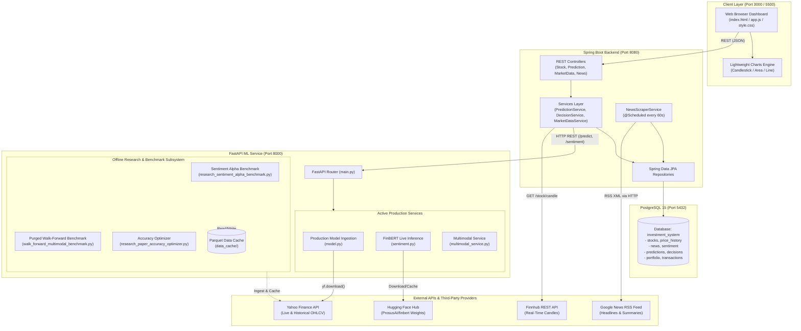
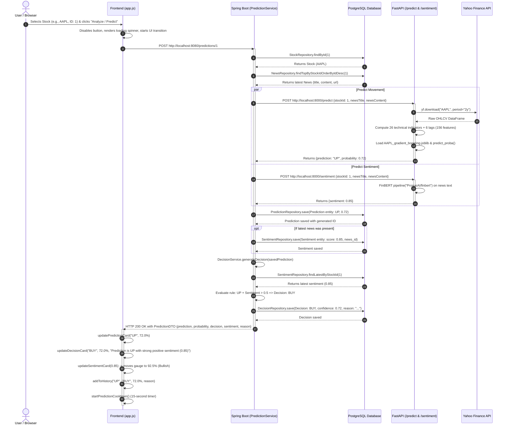

# MarketMind — Project Master Map & System Blueprint

## 1. Executive Overview

**MarketMind** is a full-stack, AI-augmented investment decision support system. It provides an automated, end-to-end analytical pipeline designed to assist retail investors and financial analysts in assessing equity securities. 

Rather than relying purely on price momentum or isolated text sentiment, MarketMind integrates:
1. **Multi-Source Financial Market Data**: Historical and real-time open-high-low-close-volume (OHLCV) price action ingested via Yahoo Finance (`yfinance`) and Finnhub REST APIs.
2. **Automated Financial News Scraping**: Unsupervised retrieval of real-time market articles from Google News RSS feeds using a Java scheduled background worker and Jsoup parser.
3. **Transformer-Based Financial Sentiment Analysis**: Deep learning natural language processing (NLP) using **FinBERT** (`ProsusAI/finbert`) to assign calibrated sentiment polarity scores to live financial news headlines and articles.
4. **Machine Learning Directional Price Forecasting**: Production gradient boosting and neural network estimators (`scikit-learn`) trained on 26 engineered technical indicators across 6 temporal lags (156 input features).
5. **Deterministic Multi-Modal Decision Engine**: Rule-based synthesis that pairs directional price movement probabilities with FinBERT sentiment scores to generate actionable **BUY**, **HOLD**, or **SELL** recommendations with explainable textual rationale.
6. **High-Performance Microservices Architecture**: Decoupled multi-tier deployment consisting of a Java 17 Spring Boot backend, a Python 3.10 FastAPI machine learning inference microservice, a PostgreSQL relational database, and a vanilla HTML/CSS/JavaScript web dashboard featuring TradingView Lightweight Charts.

---

## 2. Verified Repository Directory Tree

The following directory tree reflects the actual structure of the repository discovered on the filesystem:

```text
MarketMind/
├── .dockerignore                                      # Docker build exclusions
├── .env.example                                       # Environment variable template
├── .gitignore                                         # Git version control exclusions
├── 2025-01-01                                         # Stray empty file (accidental CLI artifact)
├── DEPLOYMENT.md                                      # Cloud and Docker deployment runbook
├── docker-compose.yml                                 # Multi-container orchestration (4 services)
├── README.md                                          # Original project overview and guide
├── render.yaml                                        # Infrastructure-as-code blueprint for Render
├── vercel.json                                        # Root deployment configuration for Vercel
│
├── AI_Investment_System_Backend/                      # Spring Boot 3.5.13 Java backend
│   ├── .dockerignore
│   ├── .gitattributes
│   ├── Dockerfile                                     # Multi-stage Docker build (Maven + Eclipse Temurin 17 JRE)
│   ├── HELP.md                                        # Default Spring Boot CLI help doc
│   ├── mvnw                                           # Linux/macOS Maven wrapper script
│   ├── mvnw.cmd                                       # Windows Maven wrapper script
│   ├── pom.xml                                        # Maven project dependencies and plugins
│   ├── README.md                                      # Backend notes
│   ├── .mvn/
│   │   └── wrapper/
│   │       └── maven-wrapper.properties
│   ├── src/
│   │   ├── main/
│   │   │   ├── java/com/investment/investment_system/
│   │   │   │   ├── InvestmentSystemApplication.java   # Spring Boot entry point (@EnableScheduling)
│   │   │   │   ├── config/
│   │   │   │   │   └── CorsConfig.java                # Global WebMvcConfigurer CORS configuration
│   │   │   │   ├── controller/
│   │   │   │   │   ├── MarketDataController.java      # Candlestick chart data REST API
│   │   │   │   │   ├── NewsController.java            # News retrieval and manual creation REST API
│   │   │   │   │   ├── PortfolioController.java       # User portfolio holdings endpoint
│   │   │   │   │   ├── PredictionController.java      # Prediction triggering REST API
│   │   │   │   │   ├── PriceHistoryController.java    # OHLCV price history CRUD endpoints
│   │   │   │   │   ├── StockController.java           # Equity security metadata endpoints
│   │   │   │   │   └── TransactionController.java     # Buy/sell trade recording endpoints
│   │   │   │   ├── dto/
│   │   │   │   │   ├── FinnhubCandleResponseDTO.java  # Jackson mapping for Finnhub candle payload
│   │   │   │   │   ├── MarketCandleDTO.java           # Internal candlestick DTO for frontend
│   │   │   │   │   ├── PortfolioDTO.java              # Portfolio valuation and position DTO
│   │   │   │   │   ├── PredictionDTO.java             # Enriched prediction + sentiment + decision DTO
│   │   │   │   │   ├── PredictionRequestDTO.java      # FastAPI prediction request payload DTO
│   │   │   │   │   ├── PredictionResponseDTO.java     # FastAPI prediction response payload DTO
│   │   │   │   │   ├── TransactionDTO.java            # Executed transaction history DTO
│   │   │   │   │   └── TransactionRequestDTO.java     # Trade execution request DTO
│   │   │   │   ├── entity/
│   │   │   │   │   ├── Decision.java                  # JPA entity for decisions table
│   │   │   │   │   ├── News.java                      # JPA entity for news table
│   │   │   │   │   ├── Portfolio.java                 # JPA entity for portfolio table
│   │   │   │   │   ├── Prediction.java                # JPA entity for predictions table
│   │   │   │   │   ├── PriceHistory.java              # JPA entity for price_history table
│   │   │   │   │   ├── Sentiment.java                 # JPA entity for sentiment table
│   │   │   │   │   ├── Stock.java                     # JPA entity for stocks table
│   │   │   │   │   ├── Transaction.java               # JPA entity for transactions table
│   │   │   │   │   └── TransactionType.java           # Enum: BUY, SELL
│   │   │   │   ├── exception/
│   │   │   │   │   ├── BadRequestException.java       # Custom HTTP 400 exception
│   │   │   │   │   └── ResourceNotFoundException.java # Custom HTTP 404 exception
│   │   │   │   ├── handler/
│   │   │   │   │   └── GlobalExceptionHandler.java    # @RestControllerAdvice global error handler
│   │   │   │   ├── repository/
│   │   │   │   │   ├── DecisionRepository.java        # Spring Data JPA repository for Decision
│   │   │   │   │   ├── NewsRepository.java            # Spring Data JPA repository for News
│   │   │   │   │   ├── PortfolioRepository.java       # Spring Data JPA repository for Portfolio
│   │   │   │   │   ├── PredictionRepository.java      # Spring Data JPA repository for Prediction
│   │   │   │   │   ├── PriceHistoryRepository.java    # Spring Data JPA repository for PriceHistory
│   │   │   │   │   ├── SentimentRepository.java       # Spring Data JPA repository for Sentiment
│   │   │   │   │   ├── StockRepository.java           # Spring Data JPA repository for Stock
│   │   │   │   │   └── TransactionRepository.java     # Spring Data JPA repository for Transaction
│   │   │   │   └── service/
│   │   │   │       ├── DecisionService.java           # Deterministic BUY/HOLD/SELL decision logic
│   │   │   │       ├── MarketDataService.java         # Finnhub & database fallback candle service
│   │   │   │       ├── MlService.java                 # HTTP client calling FastAPI ML endpoints
│   │   │   │       ├── NewsScheduler.java             # Scheduled trigger for news scraping
│   │   │   │       ├── NewsScraperService.java        # Jsoup Google News RSS parser
│   │   │   │       ├── NewsService.java               # News persistence and retrieval logic
│   │   │   │       ├── PortfolioService.java          # Portfolio calculation and DTO conversion
│   │   │   │       ├── PredictionService.java         # Orchestrates ML, sentiment, and decision flows
│   │   │   │       ├── PriceHistoryService.java       # Price history retrieval and persistence
│   │   │   │       └── TransactionService.java        # Transaction recording and portfolio updating
│   │   │   └── resources/
│   │   │       ├── application.properties             # Spring configuration (local credentials)
│   │   │       ├── application.properties.example     # Template for configuration
│   │   │       └── db.sql                             # DDL & seed script for PostgreSQL
│   │   └── test/
│   │       └── java/com/investment/investment_system/
│   │           └── InvestmentSystemApplicationTests.java # Default context loading unit test
│
├── frontend/                                          # Client dashboard UI
│   ├── .dockerignore
│   ├── Dockerfile                                     # Nginx Alpine container for static hosting
│   ├── app.js                                         # Client state management, API calls, charts
│   ├── index.html                                     # Semantic HTML5 layout
│   ├── nginx.conf                                     # Custom Nginx web server configuration
│   ├── style.css                                      # Custom CSS styling (dark cyber-fintech theme)
│   └── vercel.json                                    # Vercel routing and CORS headers
│
└── ml-service/                                        # FastAPI Python 3.10 ML & NLP service
    ├── .dockerignore
    ├── .gitignore
    ├── Dockerfile                                     # Python 3.10 slim container definition
    ├── requirements.txt                               # Pinned Python package dependencies
    ├── main.py                                        # FastAPI entry point & HTTP router
    ├── model.py                                       # Production live prediction engine (scikit-learn)
    ├── sentiment.py                                   # Live FinBERT sentiment pipeline
    ├── sentiment_engine.py                            # Advanced FinBERT NLP sentiment momentum engine
    ├── market_context.py                              # Macro benchmarks (SP500, VIX, XLK) and beta engine
    ├── regime_detector.py                             # Market regime classification (Trend, Volatility)
    ├── target_builder.py                              # Leak-free financial target definitions
    ├── confidence_filter.py                           # Selective classification and confidence curves
    ├── multimodal_features.py                         # Multimodal feature pipeline (Technicals, Macro, Sentiment)
    ├── multimodal_models.py                           # Multimodal fusion classifiers & regime mixture models
    ├── multimodal_service.py                          # Live multimodal inference service (/predict/multimodal)
    ├── populate_price_history.py                      # Data population utility script (yfinance -> Backend)
    ├── preprocess.py                                  # Legacy sequence preprocessing for LSTM prototype
    ├── data_loader.py                                 # Legacy yfinance downloader module
    ├── research_paper_accuracy_optimizer.py           # Research benchmark & feature selection script
    ├── research_sentiment_alpha_benchmark.py          # FinBERT ablation study benchmark script
    ├── walk_forward_multimodal_benchmark.py           # Purged walk-forward evaluation script
    ├── data_cache/                                    # Cached Parquet files for benchmarks
    │   ├── AAPL_2015-01-01_2024-01-01.parquet
    │   ├── AMZN_2015-01-01_2024-01-01.parquet
    │   ├── GOOGL_2015-01-01_2024-01-01.parquet
    │   ├── GSPC_2015-01-01_2024-01-01.parquet
    │   ├── IXIC_2015-01-01_2024-01-01.parquet
    │   ├── MSFT_2015-01-01_2024-01-01.parquet
    │   ├── VIX_2015-01-01_2024-01-01.parquet
    │   └── XLK_2015-01-01_2024-01-01.parquet
    ├── models/                                        # Trained production model artifacts
    │   ├── AAPL_gradient_boosting.joblib
    │   ├── AAPL_logistic_regression.joblib
    │   ├── AAPL_metadata.json
    │   ├── AMZN_gradient_boosting.joblib
    │   ├── AMZN_hist_gradient_boosting.joblib
    │   ├── AMZN_metadata.json
    │   ├── GOOGL_logistic_regression.joblib
    │   ├── GOOGL_metadata.json
    │   ├── GOOGL_mlp.joblib
    │   ├── MSFT_gradient_boosting.joblib
    │   ├── MSFT_hist_gradient_boosting.joblib
    │   └── MSFT_metadata.json
    ├── multimodal_benchmark_output/                   # Benchmark CSV output results
    └── research_paper_output/                         # Empirical research CSVs and LaTeX tables
```

---

## 3. Technology Stack Breakdown

| Component | Category | Technology / Library | Version / Source | Role in System |
|---|---|---|---|---|
| **Backend** | Language | Java | OpenJDK 17 | Core backend runtime |
| | Framework | Spring Boot | 3.5.13 | Application framework and IoC container |
| | Persistence | Spring Data JPA / Hibernate | Bundled (v3.5.13) | ORM and database repository abstraction |
| | Web / REST | Spring Web (Tomcat) | Bundled (v3.5.13) | REST controller mapping and HTTP handling |
| | HTTP Client | `RestTemplate` & `HttpClient` | Java Standard / Spring | Outbound calls to FastAPI, Finnhub, Google RSS |
| | HTML Parsing | Jsoup | 1.21.2 | Parsing Google News RSS XML/HTML payloads |
| | Utility | Project Lombok | Optional | Annotation processing for boilerplate reduction |
| | Build Tool | Apache Maven | 3.9.6 wrapper | Dependency management and build lifecycle |
| **Frontend** | Markup | HTML5 | Semantic HTML5 | Document structure and accessibility |
| | Styling | Vanilla CSS3 | Custom CSS Variables | Dark cyber-fintech UI theme and flexbox/grid layout |
| | Scripting | Vanilla JavaScript | ES6+ (Async/Await) | DOM manipulation, state handling, fetch requests |
| | Charting | TradingView Lightweight Charts | Standalone CDN v4+ | Financial line, area, and candlestick charts |
| | Typography | Google Fonts | Inter, JetBrains Mono, Teko | Modern typographic visual hierarchy |
| | Web Server | Nginx | 1.25-alpine | Production static asset server and reverse proxy |
| **ML Service** | Language | Python | 3.10 | Machine learning runtime |
| | Framework | FastAPI | 0.141.1 | High-performance asynchronous API framework |
| | ASGI Server | Uvicorn | 0.53.0 | Asynchronous HTTP server implementation |
| | Validation | Pydantic | 2.13.5 | Strict request/response schema validation |
| | NLP / Transformers | Hugging Face Transformers | 5.17.0 | Model loader for `ProsusAI/finbert` |
| | Deep Learning | PyTorch | 2.14.0 | Tensor computations supporting FinBERT |
| | Machine Learning | scikit-learn | 1.7.2 | Gradient boosting, MLPs, calibration, metrics |
| | Data Analysis | Pandas & NumPy | 2.3.3 / 2.2.6 | Technical indicator math and tabular processing |
| | Market Ingestion | yfinance | 1.7.0 | Historical price and benchmark data downloader |
| | Model Storage | Joblib | 1.6.0 | Serialized estimator persistence (`.joblib`) |
| **Database** | Relational DB | PostgreSQL | 15-alpine | Relational persistence for stocks, news, predictions |
| **DevOps** | Containerization | Docker & Docker Compose | Compose Specification | Container packaging and multi-service networking |
| | Cloud PaaS | Render | `render.yaml` | Cloud deployment configuration for backend & ML |
| | Static Hosting | Vercel | `vercel.json` | Cloud deployment configuration for frontend |

---

## 4. Overall System Architecture

The following diagram illustrates the active, multi-container system architecture, separating client interaction, service-to-service communication, external dependencies, and the offline research pipeline:



---

## 5. End-to-End Prediction Request Flow

When an end user clicks **"Analyze / Predict"** on the dashboard, the entire multi-tier system coordinates across the following exact sequence:



---

## 6. Live Production Pipeline vs. Offline Research Pipeline

A foundational finding of this audit is the **clear architectural separation** between the live operational application and the offline scientific research benchmarking suite:

```
+-------------------------------------------------------------------------------------------------------+
|                                           MARKETMIND REPOSITORY                                       |
+--------------------------------------------------+----------------------------------------------------+
|            LIVE PRODUCTION PIPELINE              |             OFFLINE RESEARCH PIPELINE              |
+--------------------------------------------------+----------------------------------------------------+
| Entry Point:                                     | Entry Points:                                      |
| - FastAPI `main.py` (:8000)                      | - `walk_forward_multimodal_benchmark.py`           |
| - Spring Boot `InvestmentSystemApplication`      | - `research_sentiment_alpha_benchmark.py`          |
|   (:8080)                                        | - `research_paper_accuracy_optimizer.py`           |
| - Frontend `index.html` (:3000 / :5500)          |                                                    |
+--------------------------------------------------+----------------------------------------------------+
| Model Architecture:                              | Model Architecture:                                |
| - Tabular scikit-learn estimators                | - Multimodal fusion models combining HistGBM,      |
|   (`AAPL_gradient_boosting.joblib`,              |   ExtraTrees, Random Forests, Logistic Regression  |
|    `GOOGL_mlp.joblib`, etc.)                     | - Calibrated soft-voting ensembles                 |
| - Live FinBERT inference (`ProsusAI/finbert`)    | - Regime-aware mixture-of-experts models           |
|   via Hugging Face pipeline                      |                                                    |
+--------------------------------------------------+----------------------------------------------------+
| Feature Engineering:                             | Feature Engineering:                               |
| - 26 Technical indicators computed live on       | - 83 multimodal features across 4 groups:          |
|   2 years of yfinance daily bars                 |   Technical (27), Market/Macro (25), Regime (10),  |
| - 6 lag steps: [1, 2, 3, 5, 10, 20]              |   Sentiment Momentum (21)                          |
| - Total feature dimensionality: 156              | - Multi-lag expansion: [1, 2, 3, 5] (332 features) |
|                                                  | - Mutual information feature selection (Top 40)    |
+--------------------------------------------------+----------------------------------------------------+
| Data Ingestion & News:                           | Data Ingestion & News:                             |
| - Live Google News RSS scraping (real text)      | - Pre-cached Parquet historical OHLCV data         |
| - Real-time Finnhub candlestick quotes           | - Latent synthetic sentiment shock generator       |
| - Active PostgreSQL persistence                  |   (price-return conditioned Gaussian simulation)   |
+--------------------------------------------------+----------------------------------------------------+
| Prediction Target:                               | Prediction Targets:                                |
| - Binary direction: UP (prob >= 0.5) vs DOWN     | - Binary forward 10-day return >= 1.5% hurdle      |
|                                                  | - 3-class trading target (BUY, HOLD, SELL)         |
|                                                  | - 5-class granular return categories               |
|                                                  | - Market-relative alpha target (vs S&P 500)        |
+--------------------------------------------------+----------------------------------------------------+
| Evaluation & Output:                             | Evaluation & Output:                               |
| - Real-time JSON responses to dashboard cards    | - Purged walk-forward out-of-sample validation     |
| - Dynamic TradingView charts & sentiment gauges  | - Selective classification confidence curves       |
|                                                  | - LaTeX academic tables and CSV performance logs   |
+--------------------------------------------------+----------------------------------------------------+
```

---

## 7. Service Entry Points and Port Matrix

| Service | Runtime / Technology | Root Directory | Entry Point File | Default Port | Primary Command |
|---|---|---|---|---|---|
| **Spring Boot Backend** | Java 17 / Maven | `AI_Investment_System_Backend/` | `src/main/.../InvestmentSystemApplication.java` | `8080` | `mvn spring-boot:run` |
| **FastAPI ML Service** | Python 3.10 / Uvicorn | `ml-service/` | `main.py` | `8000` | `uvicorn main:app --reload` |
| **PostgreSQL Database** | PostgreSQL 15 | Root / Container | `AI_Investment_System_Backend/src/main/resources/db.sql` | `5432` | `docker compose up postgres` |
| **Frontend Web UI** | Nginx / Static HTML | `frontend/` | `index.html` | `3000` (Docker) / `5500` (VS Code Live Server) | `nginx -g "daemon off;"` |

---

## 8. External Services and Third-Party Dependencies

1. **Yahoo Finance (`yfinance`)**:
   - Used by `ml-service/model.py` for live inference data (`yf.download(ticker, period="2y")`).
   - Used by `ml-service/populate_price_history.py` to seed PostgreSQL historical data (2015-2024).
   - Used by `ml-service/market_context.py` to cache macro benchmarks (`^GSPC`, `^IXIC`, `^VIX`, `XLK`).
2. **Finnhub Stock API (`finnhub.io`)**:
   - Integrated in `AI_Investment_System_Backend/.../MarketDataService.java`.
   - Fetches historical candlestick bars for requested time horizons (`/stock/candle`).
   - Gracefully falls back to local PostgreSQL `price_history` when unconfigured or rate-limited.
3. **Google News RSS Feed (`news.google.com`)**:
   - Harvested by `NewsScraperService.java` using Java `HttpClient` and `Jsoup`.
   - Query format: `https://news.google.com/rss/search?q={SYMBOL}+stock&hl=en-US&gl=US&ceid=US:en`.
4. **Hugging Face Hub (`ProsusAI/finbert`)**:
   - Ingested by `transformers.pipeline("sentiment-analysis", model="ProsusAI/finbert")`.
   - Downloaded and cached to disk on first service initialization.
5. **TradingView Lightweight Charts (CDN)**:
   - Client-side charting engine loaded via `https://unpkg.com/lightweight-charts/dist/lightweight-charts.standalone.production.js`.

---

## 9. Implementation Status Matrix

| Component / Feature | Verified Status | Evidence File & Location | Description |
|---|---|---|---|
| **Spring Boot REST APIs** | **Implemented (Active)** | `AI_Investment_System_Backend/src/.../controller/` | Stock, PriceHistory, Prediction, News, MarketData controllers operational. |
| **PostgreSQL Database Schema** | **Implemented (Active)** | `AI_Investment_System_Backend/src/.../resources/db.sql` | All 8 tables and foreign key constraints active. |
| **Automated RSS News Scraping** | **Implemented (Active)** | `AI_Investment_System_Backend/.../NewsScraperService.java` | Background scheduled task scraping Google News RSS. |
| **FinBERT Sentiment Analysis** | **Implemented (Active)** | `ml-service/sentiment.py` | ProsusAI/finbert transformer pipeline running in FastAPI. |
| **scikit-learn Directional Models** | **Implemented (Active)** | `ml-service/model.py`, `ml-service/models/` | Gradient Boosting and MLP models actively loaded from `.joblib`. |
| **Deterministic Decision Engine** | **Implemented (Active)** | `AI_Investment_System_Backend/.../DecisionService.java` | Threshold logic generating BUY/HOLD/SELL based on prediction + sentiment. |
| **Frontend TradingView Dashboard** | **Implemented (Active)** | `frontend/app.js`, `frontend/index.html` | Responsive dark UI with interactive line/area/candlestick charts. |
| **Docker Compose Orchestration** | **Implemented (Active)** | `docker-compose.yml` | 4-container networked deployment configuration. |
| **Multimodal Live Endpoint** | **Experimental (Available)** | `ml-service/main.py:65`, `ml-service/multimodal_service.py` | Route `POST /predict/multimodal` implemented but uncalled by Java backend. |
| **Portfolio & Transaction Features** | **Partially Implemented** | `AI_Investment_System_Backend/.../TransactionController.java` | Backend controllers and services exist, but UI views are missing. |
| **LSTM Price Prediction (`model.h5`)** | **Legacy / Deprecated** | `ml-service/preprocess.py`, `README.md:91` | Documented in README, but replaced by scikit-learn models in production code. |
| **Synthetic Sentiment Simulator** | **Research Only** | `ml-service/sentiment_engine.py:153` | Mathematical shock generator used only in offline backtests. |
| **Purged Walk-Forward Benchmarks** | **Research Only** | `ml-service/walk_forward_multimodal_benchmark.py` | Offline model validation scripts generating research paper artifacts. |
| **Stray Root File `2025-01-01`** | **Unverified Artifact** | Repository Root | 0-byte file created accidentally from a command-line date argument. |

---

## 10. Implementation Gaps and Unverified Items

1. **README Documentation Drift (LSTM vs. scikit-learn)**:
   - *Evidence*: `README.md` lines 16, 50, 91, 331–360 claim that the system uses a TensorFlow/Keras LSTM model saved as `model.h5`.
   - *Reality*: Production code (`ml-service/main.py` and `ml-service/model.py`) loads scikit-learn estimators (`GradientBoostingClassifier`, `HistGradientBoostingClassifier`, `MLPClassifier`) via Joblib. No TensorFlow model is loaded or trained in production.
2. **Double Scheduling of RSS News Scraping**:
   - *Evidence*: `NewsScraperService.java` line 40 has `@Scheduled(fixedRate = 60000)` on `scrapeLatestNews()`. In addition, `NewsScheduler.java` line 15 also has `@Scheduled(fixedRate = 60000)` calling `newsScraperService.scrapeLatestNews()`.
   - *Impact*: Because `@EnableScheduling` is active, Google News RSS scraping runs **twice every 60 seconds**, generating duplicate network requests.
3. **Potential NullPointerException in Portfolio Valuation**:
   - *Evidence*: `PortfolioService.java` line 29 executes `double currentPrice = portfolio.getStock().getPrice();`. In `db.sql`, stock records for GOOGL (4), MSFT (5), and AMZN (6) have `price` set to `NULL`.
   - *Impact*: Unboxing `Double` to primitive `double` throws a `NullPointerException` if a portfolio containing unpriced stocks is accessed.
4. **Bypassed Portfolio Service Layer**:
   - *Evidence*: `PortfolioController.java` line 23 directly calls `portfolioRepository.findAll()` and returns `List<Portfolio>` rather than invoking `portfolioService.getAllPortfolios()` which maps to `PortfolioDTO`.
5. **Backend CORS Annotation Inconsistencies**:
   - *Evidence*: `CorsConfig.java` defines a global WebMvcConfigurer bean. However, `PredictionController`, `NewsController`, `PriceHistoryController`, and `MarketDataController` have redundant `@CrossOrigin("*")` annotations, while `StockController`, `PortfolioController`, and `TransactionController` omit them.
6. **Unintegrated Multimodal Endpoint**:
   - *Evidence*: `ml-service/main.py` exposes `POST /predict/multimodal`, but Spring Boot's `MlService.java` only calls `POST /predict` and `POST /sentiment`. The rich regime and macro features are not yet connected to the primary user flow.
7. **Accidental Stray File**:
   - *Evidence*: The repository root contains an empty file named `2025-01-01` (size: 0 bytes), likely created by an unescaped shell redirect during a benchmark execution.
