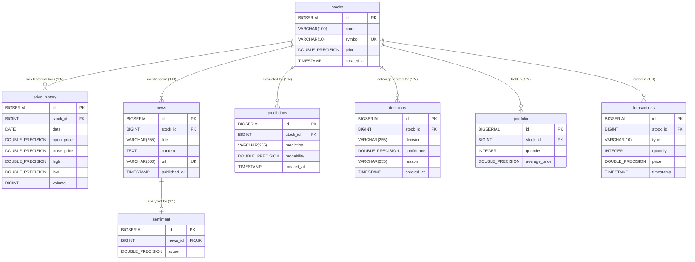

# Database Schema & Data Flow Architecture: PostgreSQL & JPA

## 1. Overview of the Persistence Layer

The persistence architecture in **MarketMind** is built on **PostgreSQL 15** managed through **Spring Data JPA** and **Hibernate ORM**. It serves as the single source of truth for stock metadata, historical price candles, scraped financial news, NLP sentiment scores, ML model predictions, generated investment decisions, and simulated portfolio transactions.

### Database Configuration & Connectivity
- **Database Name**: `investment_system`
- **Default Port**: `5432`
- **Initialization Script**: `AI_Investment_System_Backend/src/main/resources/db.sql`
- **Container Definition**: `marketmind-postgres` in `docker-compose.yml` (Image: `postgres:15-alpine`)
- **Hibernate DDL Auto Strategy**: `spring.jpa.hibernate.ddl-auto=update` in `application.properties`

---

## 2. Entity-Relationship Diagram (ERD)

The following Mermaid ER diagram illustrates the complete relational database schema, foreign key constraints, and cardinalities defined in `db.sql` and Java entities:



---

## 3. Table Schema & Mapping Inventory

### 3.1 `stocks` Table
Stores equity security profiles. Initialized with fixed IDs to synchronize the backend, frontend, and ML service.

| Column | SQL Data Type | Nullable | Constraints | Java Entity Field & Type | Description |
|---|---|---|---|---|---|
| `id` | `BIGSERIAL` | No | `PRIMARY KEY` | `Long id` | Unique stock identifier (1: AAPL, 4: GOOGL, 5: MSFT, 6: AMZN). |
| `name` | `VARCHAR(100)` | No | None | `String name` | Company corporate name (e.g., "Apple Inc."). |
| `symbol` | `VARCHAR(10)` | No | `UNIQUE` | `String symbol` | Ticker symbol (e.g., "AAPL"). |
| `price` | `DOUBLE PRECISION` | Yes | None | `Double price` | Current reference share price. |
| `created_at` | `TIMESTAMP` | Yes | `DEFAULT CURRENT_TIMESTAMP` | `LocalDateTime createdAt` | Registration timestamp. |

*Seed Records in `db.sql`:*
```sql
INSERT INTO stocks (id, name, symbol, price) VALUES
    (1, 'Apple Inc.', 'AAPL', 150.00),
    (4, 'Alphabet Inc.', 'GOOGL', NULL),
    (5, 'Microsoft Corp.', 'MSFT', NULL),
    (6, 'Amazon.com Inc.', 'AMZN', NULL);
```

### 3.2 `price_history` Table
Stores daily historical OHLCV pricing bars. Populated via `populate_price_history.py`.

| Column | SQL Data Type | Nullable | Constraints | Java Entity Field & Type | Description |
|---|---|---|---|---|---|
| `id` | `BIGSERIAL` | No | `PRIMARY KEY` | `Long id` | Unique record primary key. |
| `stock_id` | `BIGINT` | No | `FK -> stocks(id) ON DELETE CASCADE` | `Stock stock` | Associated stock entity. |
| `date` | `DATE` | No | None | `LocalDate date` | Historical trading date (ISO 8601). |
| `open_price` | `DOUBLE PRECISION` | Yes | None | `double openPrice` | Session opening price. |
| `close_price` | `DOUBLE PRECISION` | Yes | None | `double closePrice` | Session closing price. |
| `high` | `DOUBLE PRECISION` | Yes | None | `double high` | Session highest price. |
| `low` | `DOUBLE PRECISION` | Yes | None | `double low` | Session lowest price. |
| `volume` | `BIGINT` | Yes | None | `Long volume` | Total shares transacted. |

### 3.3 `news` Table
Stores financial news articles scraped by `NewsScraperService.java` from Google News RSS.

| Column | SQL Data Type | Nullable | Constraints | Java Entity Field & Type | Description |
|---|---|---|---|---|---|
| `id` | `BIGSERIAL` | No | `PRIMARY KEY` | `Long id` | Unique news article ID. |
| `stock_id` | `BIGINT` | No | `FK -> stocks(id) ON DELETE CASCADE` | `Stock stock` | Stock associated with the news. |
| `title` | `VARCHAR(255)` | No | None | `String title` | Headline text. |
| `content` | `TEXT` | Yes | None | `String content` | Full summary or body snippet. |
| `url` | `TEXT` | No | `UNIQUE` | `String url` | Canonical article link (deduplication key). |
| `published_at` | `TIMESTAMP` | Yes | None | `LocalDateTime publishedAt` | Published timestamp parsed from RFC 1123. |

### 3.4 `sentiment` Table
Stores FinBERT sentiment scores for specific news articles. Maintained as a 1:1 relationship with `news`.

| Column | SQL Data Type | Nullable | Constraints | Java Entity Field & Type | Description |
|---|---|---|---|---|---|
| `id` | `BIGSERIAL` | No | `PRIMARY KEY` | `Long id` | Sentiment score primary key. |
| `news_id` | `BIGINT` | No | `FK -> news(id) ON DELETE CASCADE, UNIQUE` | `News news` | Associated news article. |
| `score` | `DOUBLE PRECISION` | No | None | `double score` | Calibrated score from $-1.0$ to $+1.0$. |

### 3.5 `predictions` Table
Logs directional price movement predictions generated by the ML service.

| Column | SQL Data Type | Nullable | Constraints | Java Entity Field & Type | Description |
|---|---|---|---|---|---|
| `id` | `BIGSERIAL` | No | `PRIMARY KEY` | `Long id` | Prediction log record ID. |
| `stock_id` | `BIGINT` | No | `FK -> stocks(id) ON DELETE CASCADE` | `Stock stock` | Evaluated equity security. |
| `prediction` | `VARCHAR(255)` | Yes | None | `String prediction` | Categorical output ("UP" / "DOWN"). |
| `probability` | `DOUBLE PRECISION` | Yes | None | `double probability` | Confidence probability ($0.0$ to $1.0$). |
| `created_at` | `TIMESTAMP` | Yes | None | `LocalDateTime createdAt` | Evaluation timestamp. |

### 3.6 `decisions` Table
Records the final synthesized investment actions produced by `DecisionService.java`.

| Column | SQL Data Type | Nullable | Constraints | Java Entity Field & Type | Description |
|---|---|---|---|---|---|
| `id` | `BIGSERIAL` | No | `PRIMARY KEY` | `Long id` | Decision log record ID. |
| `stock_id` | `BIGINT` | No | `FK -> stocks(id) ON DELETE CASCADE` | `Stock stock` | Target equity security. |
| `decision` | `VARCHAR(255)` | Yes | None | `String decision` | Synthesized action ("BUY", "HOLD", "SELL"). |
| `confidence` | `DOUBLE PRECISION` | Yes | None | `double confidence` | Inherited model probability. |
| `reason` | `VARCHAR(255)` | Yes | None | `String reason` | Explainable decision rationale text. |
| `created_at` | `TIMESTAMP` | Yes | None | `LocalDateTime createdAt` | Generation timestamp. |

### 3.7 `portfolio` Table
Tracks user stock holdings and cost basis.

| Column | SQL Data Type | Nullable | Constraints | Java Entity Field & Type | Description |
|---|---|---|---|---|---|
| `id` | `BIGSERIAL` | No | `PRIMARY KEY` | `Long id` | Position primary key. |
| `stock_id` | `BIGINT` | No | `FK -> stocks(id)` | `Stock stock` | Owned equity security. |
| `quantity` | `INTEGER` | No | None | `int quantity` | Current share count. |
| `average_price` | `DOUBLE PRECISION` | No | None | `double averagePrice` | Weighted average purchase cost per share. |

### 3.8 `transactions` Table
Maintains an immutable audit log of executed simulated trades.

| Column | SQL Data Type | Nullable | Constraints | Java Entity Field & Type | Description |
|---|---|---|---|---|---|
| `id` | `BIGSERIAL` | No | `PRIMARY KEY` | `Long id` | Transaction audit ID. |
| `stock_id` | `BIGINT` | No | `FK -> stocks(id)` | `Stock stock` | Traded equity security. |
| `type` | `VARCHAR(10)` | No | None | `TransactionType type` | Trade type ("BUY" or "SELL"). |
| `quantity` | `INTEGER` | No | None | `int quantity` | Number of shares transacted. |
| `price` | `DOUBLE PRECISION` | No | None | `double price` | Execution price per share. |
| `timestamp` | `TIMESTAMP` | No | `DEFAULT CURRENT_TIMESTAMP` | `LocalDateTime timestamp` | Trade execution time. |

---

## 4. End-to-End Data Ingestion & Retrieval Flows

Data movement in MarketMind occurs through four distinct operational pathways:

### Pathway 1: Prediction & Decision Generation Flow
```
1. Frontend (User clicks "Analyze / Predict")
       ↓  POST /predictions/{stockId}
2. Spring Boot (PredictionController -> PredictionService)
       ↓  Query: StockRepository.findById()
       ↓  Query: NewsRepository.findTopByStockIdOrderByIdDesc()
       ↓  REST POST /predict & /sentiment -> FastAPI ML Service
       ↓  FastAPI computes scikit-learn probability & FinBERT score
       ↓  Spring Boot saves Prediction entity -> predictions table
       ↓  Spring Boot saves Sentiment entity  -> sentiment table
3. Decision Synthesis (DecisionService)
       ↓  Query: SentimentRepository.findLatestByStockId()
       ↓  Evaluates rules: (UP/DOWN + Sentiment threshold)
       ↓  Saves Decision entity -> decisions table
4. Response Assembly
       ↓  Builds PredictionDTO
       ↓  Returns HTTP 200 JSON to Frontend
5. Dashboard Dynamic Update
          - Renders prediction, decision badge, sentiment gauge, history table
```

### Pathway 2: Automated Scheduled News Harvesting
```
1. Spring Boot Background Worker (NewsScraperService @Scheduled every 60s)
       ↓  Query: StockRepository.findAll()
       ↓  Loops through AAPL, GOOGL, MSFT, AMZN
2. Outbound HTTP Request
       ↓  GET https://news.google.com/rss/search?q={symbol}+stock
3. Parsing & Filtering
       ↓  Jsoup parses RSS XML items (<title>, <link>, <description>, <pubDate>)
       ↓  Query: NewsRepository.existsByUrl(url) (deduplication)
4. Persistence
       ↓  NewsRepository.save(newNews) -> news table
```

### Pathway 3: Historical Price Population (`populate_price_history.py`)
```
1. Administrator executes populate_price_history.py
       ↓  Checks existing records: GET /price-history/{stockId}
       ↓  If empty, calls yfinance.download(start="2015-01-01", end="2024-01-01")
2. Ingestion Loop
       ↓  Row-by-row iteration over ~2,260 trading bars
       ↓  POST /price-history/{stockId} with JSON candle payload
3. Spring Boot Persistence
       ↓  PriceHistoryRepository.save(priceHistory) -> price_history table
```

### Pathway 4: Simulated Trading & Portfolio Position Management
```
1. Client dispatches trade: POST /transactions/buy (or /sell)
2. Spring Boot (TransactionController -> TransactionService @Transactional)
       ↓  Validates quantity > 0 and price > 0
       ↓  Query: PortfolioRepository.findByStock(stock)
       ↓  Recalculates weighted average cost basis or checks share balance
       ↓  Updates or removes record in portfolio table
       ↓  Inserts audit record in transactions table
3. Returns confirmation message: "Stock bought successfully"
```

---

## 5. Schema vs. Java Entity Discrepancies & Audit Findings

1. **Primitive Unboxing Danger in `PortfolioService.java`**:
   - `stocks.price` is defined as `DOUBLE PRECISION` (nullable) in `db.sql`.
   - Seed data inserts `NULL` for Alphabet, Microsoft, and Amazon (`db.sql:21–23`).
   - `PortfolioService.java:29` executes `double currentPrice = portfolio.getStock().getPrice();`. Unboxing a `null` `Double` to primitive `double` triggers a `NullPointerException` at runtime.
2. **Cascading Rule Mismatch**:
   - `db.sql` defines foreign keys with explicit `ON DELETE CASCADE` (`price_history`, `news`, `sentiment`, `predictions`, `decisions`).
   - `Stock.java` implements `cascade = CascadeType.ALL` at the JPA level. While functionally compatible, deleting entities via native SQL versus JPA entity removal follows different cascading paths.
3. **`PortfolioController` Repository Bypass**:
   - `PortfolioController.java:23` executes `portfolioRepository.findAll()`, directly returning raw entity models (`List<Portfolio>`), bypassing `PortfolioService.getAllPortfolios()` which was explicitly written to return `PortfolioDTO` with calculated position totals.
