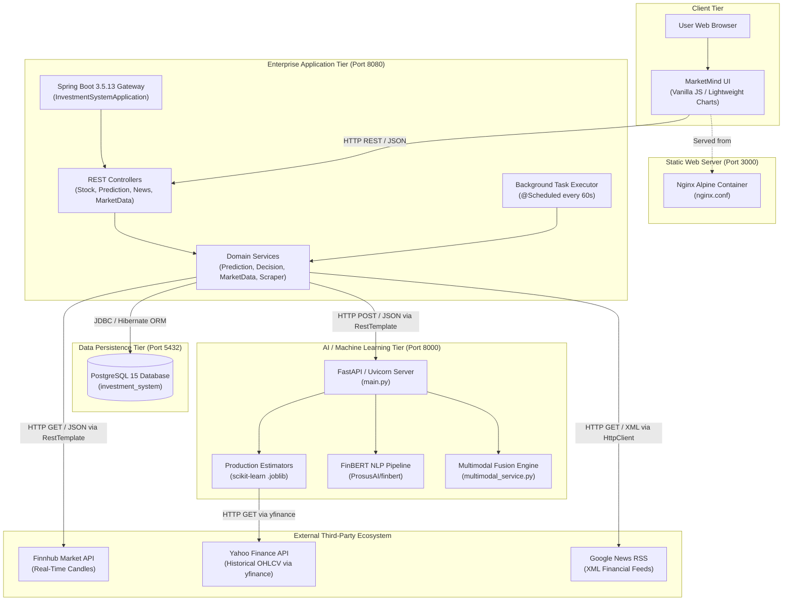
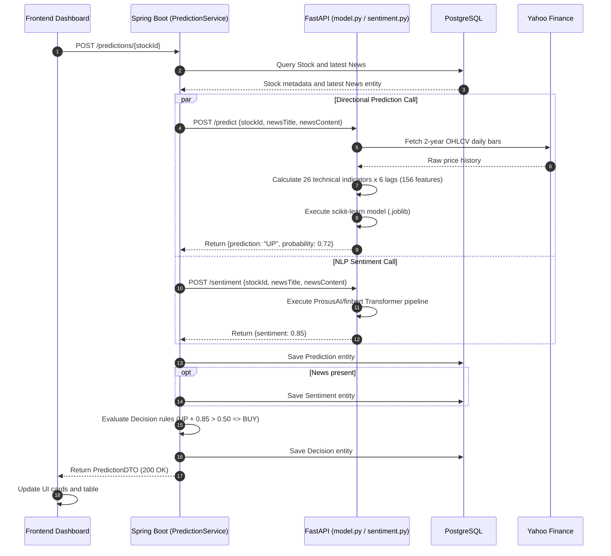
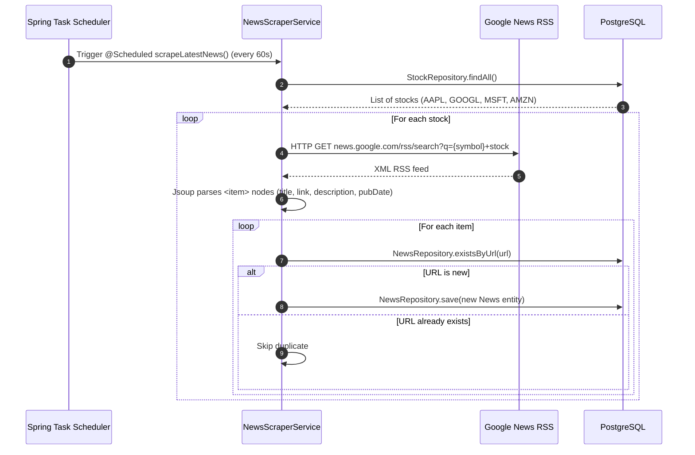
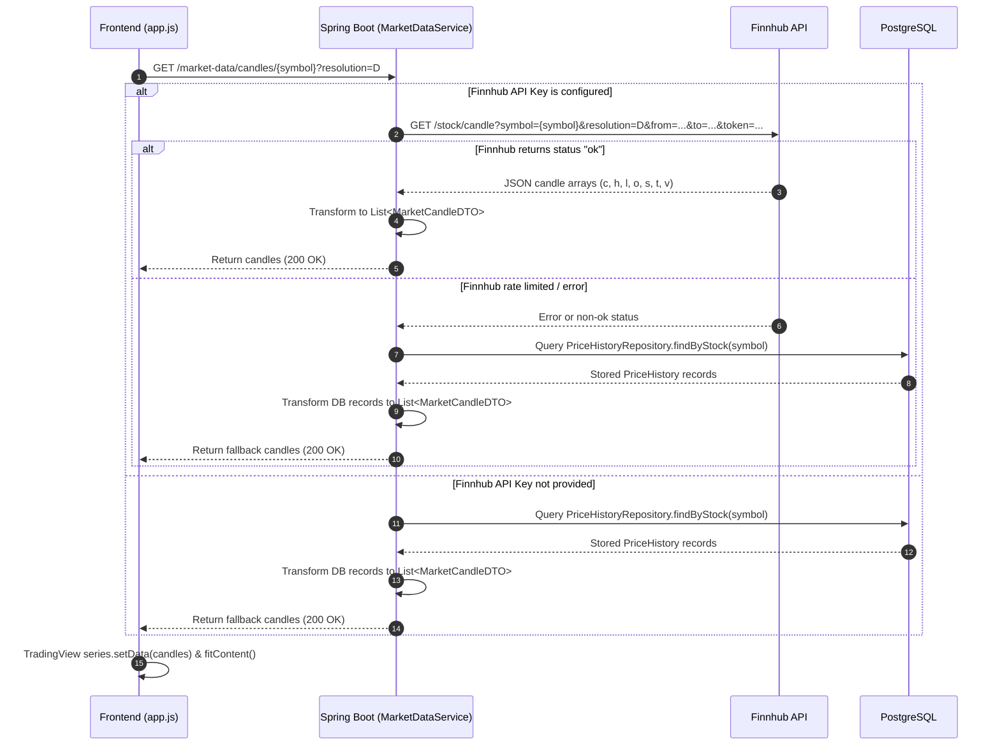

# System Architecture & Complete API Inventory

## 1. System Architecture & Component Boundaries

**MarketMind** is structured as a distributed, decoupled multi-service system. The architecture isolates compute-intensive artificial intelligence workloads (Python/FastAPI) from high-throughput enterprise persistence, scheduling, and transaction handling (Java/Spring Boot), while presenting an ultra-lightweight client dashboard (Nginx/HTML5).

### 1.1 Architectural Component Diagram

---

## 2. Exhaustive API Inventory

The following table documents every verified REST endpoint across the Spring Boot backend and the FastAPI ML service:

| Method | Endpoint | Service | Purpose | Request Body / Params | Response Payload | Status Codes | Evidence Source |
|---|---|---|---|---|---|---|---|
| `GET` | `/stocks` | Spring Boot | Lists all monitored stocks | None | `List<Stock>` | `200 OK` | `StockController.java:43` |
| `POST` | `/stocks` | Spring Boot | Registers a new stock symbol | `Stock` JSON (`name`, `symbol`, `price`) | Saved `Stock` object or error string | `200 OK`, `400 Bad Request` | `StockController.java:29` |
| `GET` | `/stocks/debug` | Spring Boot | Health check probe | None | `"Connected"` | `200 OK` | `StockController.java:24` |
| `GET` | `/price-history/{stockId}` | Spring Boot | Retrieves historical daily price bars | Path: `stockId` (Long) | `List<PriceHistory>` | `200 OK`, `404 Not Found` | `PriceHistoryController.java:31` |
| `POST` | `/price-history/{stockId}` | Spring Boot | Ingests a historical daily price bar | Path: `stockId`; Body: `PriceHistory` | Saved `PriceHistory` | `200 OK`, `404 Not Found` | `PriceHistoryController.java:23` |
| `GET` | `/news/{stockId}` | Spring Boot | Retrieves scraped news for a stock | Path: `stockId` (Long) | `List<News>` | `200 OK`, `404 Not Found` | `NewsController.java:32` |
| `POST` | `/news/{stockId}` | Spring Boot | Manually attaches a news item | Path: `stockId`; Body: `News` | Saved `News` | `200 OK`, `404 Not Found` | `NewsController.java:22` |
| `POST` | `/predictions/{stockId}` | Spring Boot | Triggers prediction, sentiment, and decision pipeline | Path: `stockId` (Long) | `PredictionDTO` | `200 OK`, `404 Not Found`, `500 Server Error` | `PredictionController.java:20` |
| `GET` | `/market-data/candles/{symbol}` | Spring Boot | Provides OHLCV candles for charts | Path: `symbol`; Query: `resolution`, `from`, `to` | `List<MarketCandleDTO>` | `200 OK`, `400 Bad Request`, `500 Server Error` | `MarketDataController.java:22` |
| `GET` | `/portfolio` | Spring Boot | Fetches user portfolio positions | None | `List<Portfolio>` | `200 OK` | `PortfolioController.java:22` |
| `POST` | `/transactions/buy` | Spring Boot | Executes a stock buy order | `TransactionRequestDTO` (`stockId`, `quantity`, `price`) | `{"message": "Stock bought successfully"}` | `200 OK`, `400 Bad Request`, `404 Not Found` | `TransactionController.java:23` |
| `POST` | `/transactions/sell` | Spring Boot | Executes a stock sell order | `TransactionRequestDTO` (`stockId`, `quantity`, `price`) | `{"message": "Stock sold successfully"}` | `200 OK`, `400 Bad Request`, `404 Not Found` | `TransactionController.java:37` |
| `GET` | `/transactions` | Spring Boot | Fetches transaction audit history | None | `List<TransactionDTO>` | `200 OK` | `TransactionController.java:51` |
| `GET` | `/` | FastAPI ML | ML service status and catalog | None | `{"message": ..., "supported_stocks": ..., "endpoints": ...}` | `200 OK` | `main.py:36` |
| `POST` | `/predict` | FastAPI ML | Directional price inference | `PredictionRequest` (`stockId`, `newsTitle`, `newsContent`) | `PredictionResponse` (`prediction`, `probability`) | `200 OK`, `422 Unprocessable` | `main.py:45` |
| `POST` | `/sentiment` | FastAPI ML | FinBERT sentiment analysis | `PredictionRequest` (`stockId`, `newsTitle`, `newsContent`) | `SentimentResponse` (`sentiment`) | `200 OK`, `422 Unprocessable` | `main.py:54` |
| `POST` | `/predict/multimodal` | FastAPI ML | Multimodal regime inference | `PredictionRequest` (`stockId`, `confidenceThreshold`, etc.) | Detailed dictionary (regime, metrics, probabilities) | `200 OK`, `422 Unprocessable` | `main.py:65` |

---

## 3. Sequence Diagrams for Core Workflows

### 3.1 Live Prediction & Decision Workflow

### 3.2 Automated Live News Scraping & Sentiment Linking

### 3.3 Candlestick Market Data Ingestion Flow

---

## 4. Failure Modes, Fault Tolerance, & Error Propagation

1. **FastAPI ML Microservice Outage**:
   - In `MlService.java:46–52`, connection failures or socket timeouts when calling `POST /predict` are intercepted by a `try-catch` block, returning a fallback DTO (`prediction: "UNKNOWN"`, `probability: 0.0`).
   - In `MlService.java:82–84`, failures when calling `POST /sentiment` fall back to score `0.0`.
   - `DecisionService.java:90` handles `"UNKNOWN"`, assigning action **HOLD** (Reason: *"Prediction is uncertain"*).
   - The application does not crash; the user receives an explainable neutral response.
2. **Finnhub Quota Exhaustion / Network Failure**:
   - `MarketDataService.java:110–118` intercepts Finnhub exceptions or empty responses and transparently switches to the internal database (`getFallbackCandlesFromDb`).
   - The frontend charts continue rendering uninterrupted from PostgreSQL records.
3. **Google News RSS Throttling**:
   - `NewsScraperService.java:109–117` catches `IOException` and `InterruptedException` per-stock, logging errors to `System.out` without terminating the scheduler thread or interrupting user requests.
