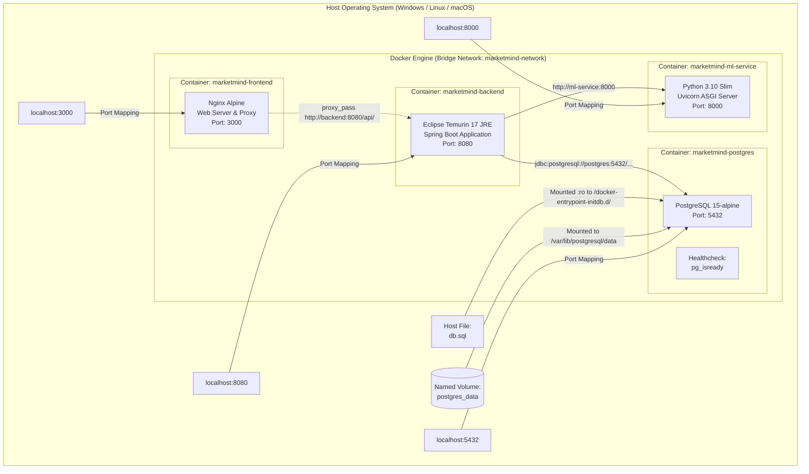

# Docker, Deployment, & DevOps Operations Guide

## 1. Containerization Architecture Overview

**MarketMind** is containerized using **Docker** and orchestrated via **Docker Compose**. Containerization decouples application runtimes from host OS quirks, guaranteeing that the Java 17 Spring Boot backend, Python 3.10 machine learning microservice, PostgreSQL 15 database, and Nginx web server operate within isolated, reproducible Linux environments.

### Orchestration Topology Diagram



---

## 2. Dockerfile Deep-Dive & Build Strategies

### 2.1 Backend Dockerfile (`AI_Investment_System_Backend/Dockerfile`)
The backend leverages a **Multi-Stage Docker Build** to minimize image size and eliminate build toolchains from the production container:

```dockerfile
# Stage 1: Build Stage (Maven + Eclipse Temurin 17 JDK)
FROM maven:3.9.6-eclipse-temurin-17 AS builder
WORKDIR /app

# Step 1: Cache dependency layer
COPY pom.xml .
RUN mvn dependency:go-offline -B

# Step 2: Copy source code and build executable JAR
COPY src ./src
RUN if [ ! -f src/main/resources/application.properties ]; then cp src/main/resources/application.properties.example src/main/resources/application.properties; fi
RUN mvn clean package -DskipTests

# Stage 2: Runtime Image (Lightweight JRE)
FROM eclipse-temurin:17-jre-jammy
WORKDIR /app

# Security: Non-root user execution
RUN groupadd -r spring && useradd -r -g spring spring
USER spring:spring

# Copy built JAR from builder stage
COPY --from=builder /app/target/*.jar app.jar
EXPOSE 8080
ENTRYPOINT ["java", "-Djava.security.egd=file:/dev/./urandom", "-jar", "app.jar"]
```

#### Architectural Rationale
1. **Layer Caching**: `pom.xml` is copied and resolved (`dependency:go-offline`) before copying source code. Edits to Java files do not trigger re-downloading Maven dependencies.
2. **Minimal Attack Surface**: The production image uses `eclipse-temurin:17-jre-jammy` (~200MB) instead of the full Maven SDK image (~800MB).
3. **Least Privilege Security**: Creates a system group `spring` and unprivileged user `spring:spring`, avoiding running container workloads as root.
4. **Fast Entropy Generation**: `-Djava.security.egd=file:/dev/./urandom` prevents cryptographic blocking during Tomcat startup.

### 2.2 ML Service Dockerfile (`ml-service/Dockerfile`)
Containers for Python machine learning services require compilation tools for packages like `scipy` or `tokenizers`:

```dockerfile
FROM python:3.10-slim

ENV PYTHONDONTWRITEBYTECODE=1 \
    PYTHONUNBUFFERED=1 \
    DEBIAN_FRONTEND=noninteractive

WORKDIR /app

RUN apt-get update && apt-get install -y --no-install-recommends \
    build-essential \
    curl \
    && rm -rf /var/lib/apt/lists/*

COPY requirements.txt .
RUN pip install --no-cache-dir --upgrade pip && \
    pip install --no-cache-dir -r requirements.txt

COPY . .
EXPOSE 8000
CMD ["uvicorn", "main:app", "--host", "0.0.0.0", "--port", "8000"]
```

#### Key Directives
- `PYTHONDONTWRITEBYTECODE=1`: Prevents Python from writing `.pyc` files into container layers.
- `PYTHONUNBUFFERED=1`: Ensures stdout/stderr log streams flush directly into the Docker logger.
- `--no-install-recommends` & `rm -rf /var/lib/apt/lists/*`: Discards Debian package caches to keep the image slim.
- `--no-cache-dir`: Prevents caching pip `.whl` files on disk.

### 2.3 Frontend Dockerfile (`frontend/Dockerfile`)
The client UI is packaged within an Alpine-based Nginx container:

```dockerfile
FROM nginx:alpine
RUN rm /etc/nginx/conf.d/default.conf
COPY nginx.conf /etc/nginx/conf.d/default.conf
COPY . /usr/share/nginx/html
EXPOSE 3000
CMD ["nginx", "-g", "daemon off;"]
```

---

## 3. Docker Compose Orchestration Specification

The root `docker-compose.yml` file configures all four services into a unified application cluster:

| Service Name | Container Name | Base Image / Context | Port Mapping | Dependencies & Conditions | Volumes & Mounts |
|---|---|---|---|---|---|
| `postgres` | `marketmind-postgres` | `postgres:15-alpine` | `5432:5432` | None | - `postgres_data:/var/lib/postgresql/data`<br/>- `./.../db.sql:/docker-entrypoint-initdb.d/01-init.sql:ro` |
| `ml-service` | `marketmind-ml-service` | `./ml-service` | `8000:8000` | None | None |
| `backend` | `marketmind-backend` | `./AI_Investment_System_Backend` | `8080:8080` | - `postgres` (`service_healthy`)<br/>- `ml-service` (`service_started`) | None |
| `frontend` | `marketmind-frontend` | `./frontend` | `3000:3000` | `backend` (`service_started`) | None |

### 3.1 Inter-Service DNS & Network Communication
- **Network Driver**: Custom bridge network `marketmind-network`.
- **Automatic Service Discovery**:
  - The Spring Boot backend connects to PostgreSQL via container hostname: `jdbc:postgresql://postgres:5432/investment_system`.
  - The Spring Boot backend connects to FastAPI via container hostname: `http://ml-service:8000`.
- **Health-Checked Startup Dependency**:
  `backend` specifies `depends_on: postgres: { condition: service_healthy }`. Docker Compose verifies that PostgreSQL is actively accepting connections (`pg_isready`) before launching the Spring Boot JVM.

---

## 4. Cloud Deployment Architecture

`DEPLOYMENT.md` specifies configurations across three deployment patterns:

### 4.1 Cloud PaaS Deployment (Render / Vercel)
- **Render (`render.yaml`)**:
  - Automatically provisions a free PostgreSQL database (`marketmind-db`).
  - Deploys `marketmind-backend` as a Docker web service, injecting host, port, user, and password directly from the database resource.
  - Deploys `marketmind-ml` as a Docker web service in the Oregon region.
- **Vercel (`vercel.json`)**:
  - Hosts the static `frontend/` directory with clean URLs, CORS headers, and asset caching.
  - The client `app.js` resolves `API_BASE_URL` to `https://marketmind-backend.onrender.com`.

### 4.2 Cloud VM / VPS Deployment (AWS EC2 / DigitalOcean)
- Provisions Ubuntu 22.04 LTS (recommended: 2 vCPUs, 2GB+ RAM).
- Installs Docker Engine and Docker Compose v2.
- Clones repository, sets environment variables in `.env`, and executes `docker compose up --build -d`.
- Exposes port 3000 (UI), port 8080 (API), port 8000 (ML), and port 5432 (DB).

---

## 5. Operations & Execution Runbook

### 5.1 Local Multi-Container Launch
```bash
# 1. Create local environment file from template
cp .env.example .env

# 2. Build and launch all 4 containers in detached mode
docker compose up --build -d

# 3. Monitor live log streams across all services
docker compose logs -f

# 4. Verify running container health
docker compose ps

# 5. Stop and tear down container cluster
docker compose down
```

### 5.2 Seeding Historical Price Bars in Docker
Once the Docker containers are running, execute the price population utility locally or inside the ML container:
```bash
# Run locally using virtual environment:
cd ml-service
python populate_price_history.py
```

---

## 6. Common DevOps Failure Modes & Troubleshooting

| Failure Scenario | Root Cause | Diagnosis Command | Verified Resolution |
|---|---|---|---|
| **Spring Boot fails to start with connection refused on port 5432** | PostgreSQL container is still initializing or healthy condition failed. | `docker compose logs backend` | Ensure `depends_on` includes `condition: service_healthy` for postgres. Check credentials in `.env`. |
| **FastAPI container killed during build** | Insufficient RAM during `pip install torch` or `transformers`. | `docker compose logs ml-service` | Increase Docker desktop memory limit to at least 4GB or install pre-built wheels. |
| **Frontend displays error banner: "Unable to load price action"** | Browser cannot reach port 8080 due to firewall or wrong `API_BASE_URL`. | Browser DevTools Network tab | Verify `API_BASE_URL` in `app.js` matches the accessible backend host. |
| **FinBERT download failure** | Container lacks outbound internet access on first run. | `docker compose logs ml-service` | Verify container DNS settings. Hugging Face requires outbound HTTPS access to download weights. |

---

## 7. CI/CD & Automated Pipelines Audit

- **GitHub Actions (`.github/workflows`)**: **Not found in current implementation**.
- **Automated Testing Pipelines**: **Not found in current implementation**.
- **Conclusion**: Continuous Integration and Continuous Deployment (CI/CD) pipelines are currently manual. Deployment relies on manual Docker Compose execution on a VPS or auto-deploy triggers connected via GitHub repository integrations on Render and Vercel.
